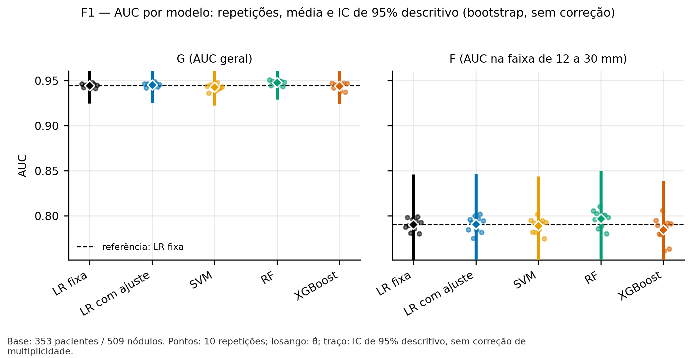
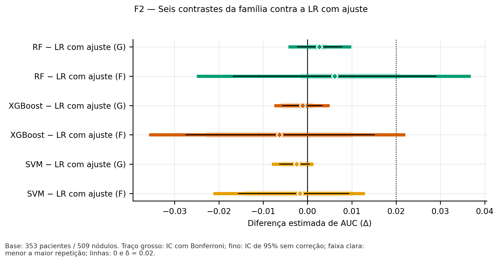
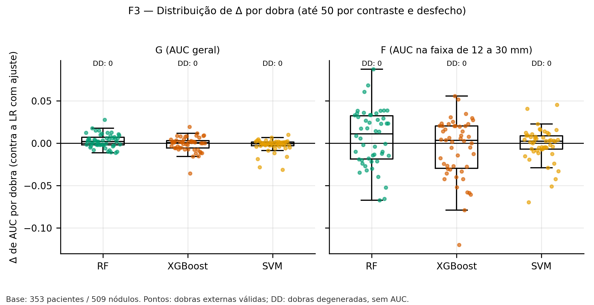
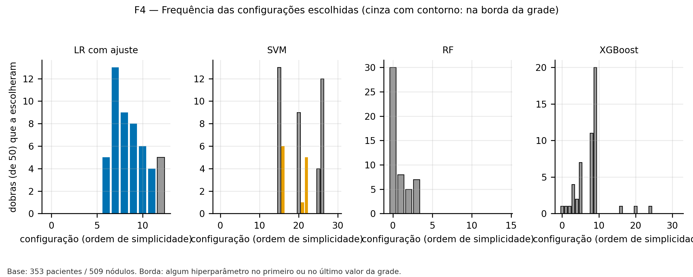
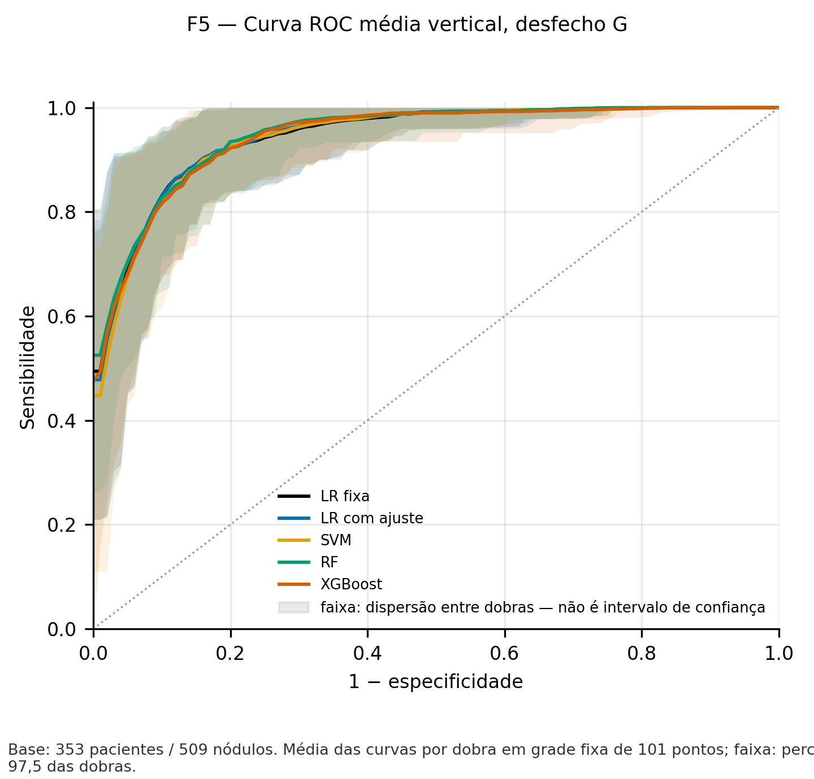
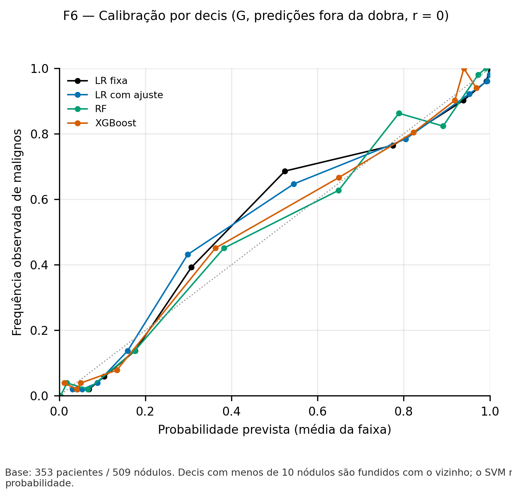
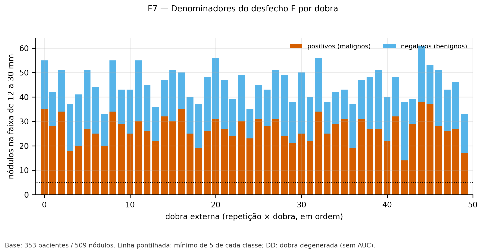
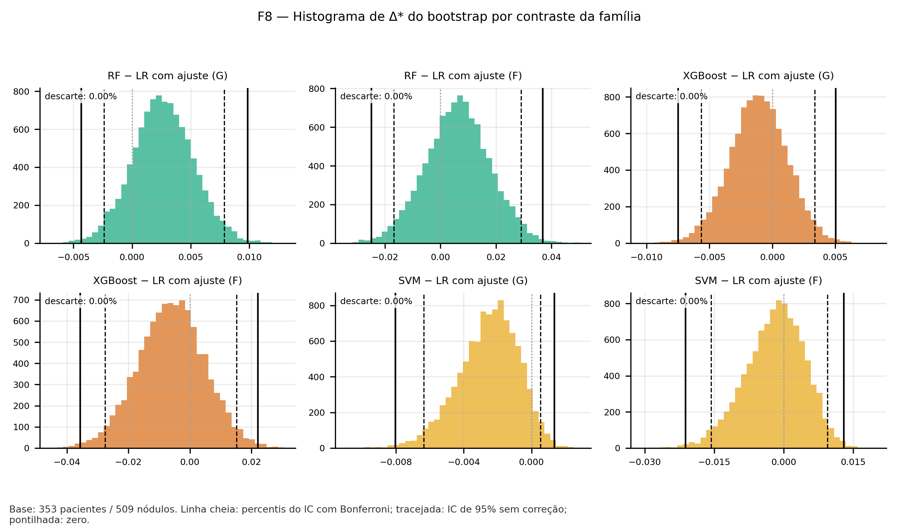

# Guia de revisão — benchmark de classificadores da Sprint 6 (P9)

**Natureza:** guia de leitura para a revisão humana. **Não é resultado novo, não altera o pré-registro P9 e não substitui o relatório congelado.** Todos os números abaixo foram transcritos dos arquivos em [`reports/sprint6/benchmark/`](../../reports/sprint6/benchmark/) e conferidos contra o [resumo](../../reports/sprint6/benchmark/resumo_benchmark.md); nada foi recalculado nem editado.
**Data de preparação:** 03/11/2026 · **Situação:** pronto para revisão da equipe; **nada foi publicado** (sem push, PR novo ou merge) e o card do Trello **não** está concluído.
**Leitura rápida:** as cinco configurações discriminam quase igual nesta base (AUC geral entre 0,942 e 0,948). Nenhum desafiante supera a regressão logística com ajuste pelos critérios pré-registrados, e a regra recomenda **a LR com ajuste**. A recomendação é condicional e descritiva, não confirmatória.

---

## 1. Escopo e pergunta

- **Pergunta (P9, Seção 1):** com as **três características de forma** do baseline — `original_shape_MeshVolume`, `original_shape_Maximum3DDiameter` e `original_shape_Sphericity` —, nesta base, algum algoritmo mais flexível discrimina melhor do que a regressão logística com ajuste interno de `C`?
- **Algoritmos:** regressão logística com ajuste (LR com ajuste), Random Forest (RF), XGBoost (XGB) e SVM de kernel RBF. A regressão logística fixa do baseline (`C = 1`) entra como **referência histórica**.
- **O alvo é suspeição radiológica**, e não diagnóstico histopatológico de câncer. Nada aqui é validação clínica.
- **Fora de escopo:** valor incremental das oito características radiômicas (objeto da S4), o conjunto de teste histórico e qualquer modelo ou experimento além dos pré-registrados.

## 2. Metodologia (resumo do P9)

| Item | Valor |
|---|---|
| Base | 353 pacientes / 509 nódulos (treino + validação oficiais); 258 benignos e 251 malignos |
| Validação | cruzada aninhada **agrupada por paciente**: 10 repetições × 5 dobras externas, 5 dobras internas para o ajuste de hiperparâmetros; **as mesmas dobras para todos os modelos** (50 dobras externas por desfecho) |
| Desfecho G | AUC-ROC geral por dobra externa |
| Desfecho F | AUC-ROC só nos nódulos com `12 ≤ D < 30 mm` (`D = original_shape_Maximum3DDiameter`): **226 nódulos, 187 pacientes, 135 positivos, 91 negativos**. Os modelos são treinados com todos os nódulos; a faixa só recorta a avaliação |
| Incerteza | bootstrap por paciente (B = 10.000, semente 42), **condicional**: não reajusta os modelos nas réplicas. IC de 95% descritivo e IC com Bonferroni (seis contrastes, percentis 0,41667 e 99,58333) |
| Teste histórico | **não usado** em modelagem, ajuste, validação cruzada, métricas, bootstrap nem seleção |
| Ambiente | Python 3.9.13, scikit-learn 1.3.2, numpy 1.23.5, pandas 1.5.3, scipy 1.10.1, XGBoost 2.1.4 (conforme o relatório) |

Execução: **250 unidades** (5 modelos × 10 repetições × 5 dobras), **0 falhas técnicas pendentes**, nenhuma dobra degenerada, 10 de 10 repetições válidas nos dois desfechos.

## 3. Resultado principal — AUC por modelo

θ̂ é a média, entre as repetições, da média das AUC das dobras. O intervalo é o IC de 95% descritivo do bootstrap (sem correção de multiplicidade). Valores iguais aos do relatório (aqui com vírgula decimal).

| Modelo | AUC G | IC 95% (G) | AUC F | IC 95% (F) |
|---|--:|---|--:|---|
| LR fixa | 0,9442 | [0,9246; 0,9624] | 0,7903 | [0,7359; 0,8460] |
| LR com ajuste | 0,9449 | [0,9254; 0,9628] | 0,7907 | [0,7364; 0,8464] |
| SVM | 0,9424 | [0,9224; 0,9605] | 0,7890 | [0,7357; 0,8437] |
| RF | 0,9476 | [0,9288; 0,9646] | 0,7968 | [0,7459; 0,8501] |
| XGBoost | 0,9438 | [0,9242; 0,9619] | 0,7844 | [0,7329; 0,8389] |

- A estimativa da **LR com ajuste** é rotulada pelo relatório como *otimista por seleção* (ver a Seção 5).
- As diferenças pontuais entre modelos em G (no máximo 0,0052) são menores que a largura de qualquer intervalo; em F, os intervalos têm cerca de 0,11 de largura.

## 4. Contrastes contra a LR com ajuste

Δ é a diferença estimada de AUC (desafiante − LR com ajuste); a última coluna é o número de repetições com Δ > 0. O zero é o ponto de "nenhuma diferença"; o limiar operacional δ = 0,02 só entra na regra de seleção (Seção 5).

| Contraste | Desfecho | Δ estimado | IC com Bonferroni | IC 95% sem correção | Repetições com Δ > 0 |
|---|---|--:|---|---|--:|
| RF − LR com ajuste | G | 0,0027 | [-0,0043; 0,0098] | [-0,0024; 0,0078] | 10 de 10 |
| RF − LR com ajuste | F | 0,0061 | [-0,0250; 0,0368] | [-0,0168; 0,0291] | 8 de 10 |
| XGBoost − LR com ajuste | G | -0,0011 | [-0,0075; 0,0050] | [-0,0057; 0,0034] | 6 de 10 |
| XGBoost − LR com ajuste | F | -0,0063 | [-0,0358; 0,0221] | [-0,0276; 0,0152] | 3 de 10 |
| SVM − LR com ajuste | G | -0,0025 | [-0,0080; 0,0013] | [-0,0064; 0,0005] | 1 de 10 |
| SVM − LR com ajuste | F | -0,0017 | [-0,0213; 0,0129] | [-0,0157; 0,0094] | 4 de 10 |

**Como ler:** todos os seis intervalos com Bonferroni **contêm o zero**; o relatório os apresenta como descritivos e condicionais, não como teste de hipótese. O maior Δ pontual é o da RF em G (+0,0027), muito abaixo de δ. A RF superar a LR em 10 de 10 repetições em G indica consistência do **sinal** da diferença, não relevância do tamanho dela.

## 5. Regra de escolha do algoritmo (C1–C4)

O padrão é a **LR com ajuste**. Um desafiante só seria recomendado se cumprisse os quatro critérios (P9, Seção 10; D5):

- **C1:** Δ estimado em G ≥ 0,02;
- **C2:** Δ positivo em pelo menos 80% das repetições válidas;
- **C3:** F estimável e Δ em F ≥ 0;
- **C4:** sem falha técnica pendente, G estimável e sem aviso de não convergência.

| Desafiante | C1 | C2 | C3 | C4 | Elegível |
|---|:-:|:-:|:-:|:-:|:-:|
| RF | não | sim | sim | sim | não |
| SVM | não | não | não | sim | não |
| XGBoost | não | não | não | sim | não |

**Resultado: algoritmo recomendado = LR com ajuste**, porque nenhum desafiante chega a ΔAUC geral ≥ 0,02. A RF tem a maior AUC pontual em G e em F, mas isso **não** altera C1–C4 e **não** é uma seleção confirmatória. O intervalo e a taxa de descarte do bootstrap não entram na regra. Como a escolha vem dos mesmos resultados de validação cruzada que a estimam, a AUC da LR com ajuste é otimista por seleção, e nenhuma correção formal foi aplicada.

## 6. Figuras F1–F8

Cada figura existe em PNG (exibido aqui) e SVG, com os dados no CSV indicado. Os arquivos estão **no diretório congelado**, e as referências abaixo são relativas. Itens **editoriais** estão marcados e listados na Seção 9.

### F1 — AUC geral e na faixa

[SVG](../../reports/sprint6/benchmark/figuras/F1.svg) · [dados](../../reports/sprint6/benchmark/figuras/dados/F1.csv)

**O que mostra:** a AUC de cada modelo nas 10 repetições (pontos), a média θ̂ (losango) e o IC de 95% descritivo (traço), para G (esquerda) e F (direita); a linha tracejada é a LR fixa. **O que se observa:** em G, os cinco modelos ficam em torno de 0,94–0,95 com intervalos sobrepostos; em F, a AUC cai para cerca de 0,78–0,80 e os intervalos são muito mais largos. **Não se pode inferir** ordem confiável entre modelos: a sobreposição é total e o intervalo ignora a variabilidade de treinamento.

### F2 — Seis contrastes da família

[SVG](../../reports/sprint6/benchmark/figuras/F2.svg) · [dados](../../reports/sprint6/benchmark/figuras/dados/F2.csv)

**O que mostra:** Δ de AUC de RF, XGBoost e SVM contra a LR com ajuste, em G e F: traço grosso = IC com Bonferroni; fino = IC de 95% sem correção; faixa clara = menor a maior repetição; linhas em 0 e em δ = 0,02. **O que se observa:** todos os intervalos cruzam o zero e nenhuma estimativa se aproxima de 0,02; os intervalos com Bonferroni de F são de 3,7 a 4,6 vezes mais largos que os de G. **Não se pode inferir** equivalência entre os algoritmos (intervalos largos não provam ausência de diferença) nem superioridade de nenhum.

### F3 — Δ por dobra

[SVG](../../reports/sprint6/benchmark/figuras/F3.svg) · [dados](../../reports/sprint6/benchmark/figuras/dados/F3.csv)

**O que mostra:** a diferença de AUC em cada uma das até 50 dobras externas, por contraste, com caixa e bigodes; "DD" conta dobras degeneradas (sem AUC). **O que se observa:** em G, os Δ ficam perto de zero e com pouca dispersão; em F, a dispersão por dobra é muito maior (de cerca de −0,12 a +0,09), e nenhuma dobra é degenerada (DD: 0). **Não se pode inferir** independência entre as dobras: elas compartilham pacientes de treino, e por isso o relatório trata a variação entre repetições só como mínimo e máximo.

### F4 — Hiperparâmetros escolhidos e borda da grade

[SVG](../../reports/sprint6/benchmark/figuras/F4.svg) · [dados](../../reports/sprint6/benchmark/figuras/dados/F4.csv)

**O que mostra:** quantas das 50 dobras escolheram cada configuração da grade, em ordem de simplicidade; cinza com contorno marca configuração na **borda** da grade. **O que se observa:** RF e XGBoost escolheram configuração na borda em 50 de 50 dobras e o SVM em 38 de 50 (a LR com ajuste, em 5 de 50). **Não se pode inferir** o ótimo real desses modelos: a grade é fixa por pré-registro e a borda sugere que valores fora dela poderiam ser melhores, o que **não foi testado** (e não pode ser sem adendo). **Item editorial:** os rótulos do eixo inferior se sobrepõem e o do último painel está cortado.

### F5 — Curva ROC média, desfecho G

[SVG](../../reports/sprint6/benchmark/figuras/F5.svg) · [dados](../../reports/sprint6/benchmark/figuras/dados/F5.csv)

**O que mostra:** a curva ROC média por modelo (grade fixa de 101 pontos) e, em faixa, a dispersão entre dobras (percentis 2,5 e 97,5), que a própria legenda declara **não ser intervalo de confiança**. **O que se observa:** as cinco curvas são quase indistinguíveis e as faixas se sobrepõem. **Não se pode inferir** diferença de desempenho em pontos de operação específicos nem incerteza do estimador. **Item editorial:** o texto do rodapé está cortado à direita.

### F6 — Calibração por decis (G, repetição 0)

[SVG](../../reports/sprint6/benchmark/figuras/F6.svg) · [dados](../../reports/sprint6/benchmark/figuras/dados/F6.csv)

**O que mostra:** a frequência observada de malignos contra a probabilidade média prevista, por decil, usando predições fora da dobra da **repetição 0**; decis com menos de 10 nódulos são fundidos com o vizinho; o SVM não aparece, porque não produz probabilidade (D10). **O que se observa:** as LR ficam acima da diagonal entre as probabilidades previstas de cerca de 0,3 e 0,55, e a RF é irregular acima de 0,7. **Não se pode inferir** calibração geral: é uma única repetição, com poucos nódulos por decil. As métricas de calibração por dobra estão no relatório (inclinação média 1,11 a 1,20 entre as LR, RF e XGBoost). **Item editorial:** o rodapé está cortado à direita.

### F7 — Denominadores do desfecho F

[SVG](../../reports/sprint6/benchmark/figuras/F7.svg) · [dados](../../reports/sprint6/benchmark/figuras/dados/F7.csv)

**O que mostra:** por dobra externa, os nódulos da faixa de 12 a 30 mm divididos em positivos e negativos; a linha pontilhada é o mínimo de 5 de cada classe exigido para calcular a AUC. **O que se observa:** as 50 dobras ficam acima do mínimo (de 33 a 61 nódulos por dobra; no mínimo 14 positivos e 10 negativos). **Não se pode inferir** estabilidade da AUC de F só por isso: dobras pequenas ainda geram AUC ruidosa, e é o que a largura dos intervalos de F mostra.

### F8 — Bootstrap dos seis contrastes

[SVG](../../reports/sprint6/benchmark/figuras/F8.svg) · [dados](../../reports/sprint6/benchmark/figuras/dados/F8.csv)

**O que mostra:** a distribuição de Δ* nas 10.000 réplicas por contraste; linha cheia = percentis do IC com Bonferroni; tracejada = IC de 95% sem correção; pontilhada = zero; "descarte" = fração de réplicas descartadas. **O que se observa:** as distribuições são unimodais e aproximadamente simétricas, com descarte de 0,00% em todas. No SVM − LR (G), o limite superior do IC de 95% fica muito perto de zero (+0,0005). **Não se pode inferir** que o bootstrap capture a variabilidade de treinamento ou da escolha de hiperparâmetros: ele não reajusta os modelos (Seção 8).

## 7. Rastreabilidade

| O que | Onde | Identificação |
|---|---|---|
| Relatório principal (congelado) | [`resumo_benchmark.md`](../../reports/sprint6/benchmark/resumo_benchmark.md) | SHA-256 (LF): `f6896c10e2fbe2b2b9b570edf785fb9a2d27ceb7723ccf45f55e4b7f484354c9` |
| Números estruturados | [`relatorio_benchmark.json`](../../reports/sprint6/benchmark/relatorio_benchmark.json) | `d5ee08b0fe24a8fb3e1925aade0650613e4e65e73084b23b0f9e41aa65e73081` |
| Manifesto da execução | [`manifesto_benchmark.json`](../../reports/sprint6/benchmark/manifesto_benchmark.json) | `824c1b3c4dcf62240f40ff379e61c66b63546959db8791fe3ff4881b82bbdb0c`; modo `definitivo`, oficial, elegível; 38 saídas |
| Configuração canônica | [`config_benchmark_p9.json`](config_benchmark_p9.json) | SHA-256 canônico `a0d096a5415244f17f40360a2a5a8901bc8af1da5cf8687b891f920e1ee122b3` (igual ao calculado pelo código) |
| Pré-registro P9 e registros | [`preregistro_p9_benchmark.md`](preregistro_p9_benchmark.md), Seção 19 | registros `P9` (`c4cc126`) e `S4_E3_REGISTRADA` (`c124c81`) |
| Etapa 3 da S4 (manifesto) | [`manifesto_etapa3_validacao.json`](../../reports/sprint4/etapa3_validacao/manifesto_etapa3_validacao.json) | SHA-256 canônico `1ad800ea62a85be1a38ddcd6b1c68566e573cf2ac55e8ae73f2770aa21ff5705`; execução em `ac8102f` |
| Adendo de ordem das etapas | [`adendo_01_ordem_das_etapas.md`](../sprint4/adendo_01_ordem_das_etapas.md) | S4 `c9c2a2b` |
| Estado e plano | [`estado_execucao_plano.md`](estado_execucao_plano.md), [`PLANO_EXECUCAO_AUTONOMA_BENCHMARK_S6.md`](PLANO_EXECUCAO_AUTONOMA_BENCHMARK_S6.md), [`PLANO_PUBLICACAO_REVISAO_BENCHMARK_S6.md`](PLANO_PUBLICACAO_REVISAO_BENCHMARK_S6.md) | os planos são instruções operacionais, **não** resultados nem autorização |

- **Commit da execução definitiva:** `c124c81`; **commit dos artefatos congelados:** `22d6a9b` (branch `feat/s6-benchmark-executor`).
- **Verificação:** `python -m src.benchmark_s6 --modo verificar` foi aprovado em `22d6a9b` ("38 saídas conferem; recálculo idêntico; git, código e ambiente ok"), com a árvore limpa. **Essa verificação só vale nesse HEAD:** a guarda recusa mudanças fora de `reports/sprint6/benchmark/` depois da execução, então qualquer commit posterior (inclusive este guia) a faz falhar por desenho. A evidência é o estado `22d6a9b`.
- **Testes comunicados (não repetidos nesta fase):** suíte da S4, 508 testes aprovados; suíte da S6, 613 aprovados e 1 ignorado (`C:\PI3\logs_s6\` fora do Git).
- **Dados individuais:** nenhum no repositório. Os CSV trazem só agregados por modelo, repetição e dobra; não há identificadores de paciente ou nódulo, e os checkpoints (`C:\PI3\checkpoints_s6_def`) e a tabela-fonte ficam fora do Git.
- **PRs:** o pré-registro está no PR #11 (rascunho). Não há PR aberto para a S4 nem para o executor da S6. Ver [`PRS_BENCHMARK_S6_DESCRICOES.md`](PRS_BENCHMARK_S6_DESCRICOES.md).

## 8. Limitações

- **IC condicional:** o bootstrap reamostra a avaliação e não reajusta os modelos; o intervalo tende a ser estreito demais, e a variabilidade da escolha de hiperparâmetros também fica de fora.
- **Dependência entre dobras e repetições:** os treinos se sobrepõem; a partição só aparece como mínimo e máximo entre repetições.
- **Otimismo da escolha:** o algoritmo recomendado sai dos mesmos resultados usados para estimá-lo, sem correção formal.
- **Bonferroni:** é convenção de largura, não garantia de controle do erro de família (os seis contrastes compartilham o comparador e F é subconjunto de G).
- **Alvo radiológico:** suspeição radiológica, não histopatologia; sem generalização clínica.
- **Validação não independente:** os pacientes de validação já tinham sido usados na Etapa 3 da S4 (o P9 declara essa reutilização); o teste histórico não é evidência independente e não entra aqui.
- **Bordas das grades** (F4): RF, XGBoost e SVM escolheram configurações nos limites; o resultado vale para as grades pré-registradas.
- **S4:** as Etapas 1 e 2 oficiais ainda não foram executadas (o Adendo 1 fixa que vêm depois da Etapa 3), e circularidade (§10.3) e máscaras reduzidas (§10.4) ficam para atividade própria. Nenhuma delas foi feita.

## 9. Pendências e itens para a equipe

> **Revisão solicitada à equipe — escopo:** confirmar se a aprovação do P9 supre o requisito "diâmetro isolado" originalmente escrito no card ou se esta referência permanece como tarefa separada. O benchmark executado não deve ser rotulado como tendo incluído diâmetro isolado sem evidência correspondente. Nenhum experimento adicional será criado nesta entrega sem decisão formal.

O card pede "diâmetro isolado como referência", enquanto o P9 compara cinco configurações que usam as **três** características de forma, com a LR fixa como referência histórica. **Não é o mesmo baseline**, e o DoD **não** é dado como plenamente conciliado antes da resposta da equipe.

| # | Item | Estado |
|---|---|---|
| 1 | Escopo do "diâmetro isolado" (acima) | **decisão humana pendente** |
| 2 | F4, F5 e F6: ajustes de layout sugeridos (rótulos sobrepostos ou cortados); **nenhum dado ou métrica alterado** | editorial; os originais ficam intactos. Se a equipe pedir correção, é uma intervenção controlada: nova geração, novos hashes e manifesto, nova revisão antes de substituir; o manifesto atual não valeria para arquivos editados |
| 3 | Confirmação de D2 (limites [12, 30] do Exp. 26.0.1 e [12, 30) do P9) | evidências (`piso_26_0_1.py`, `26_0_1_resumo.json`) **não estão no repositório** nem foram inspecionadas; contagens 226/187/135/91 coincidem |
| 4 | Etapas 1 e 2 oficiais da S4; circularidade e máscaras reduzidas | **não executadas** |
| 5 | Push, PRs e merge | **nada publicado**; depende de autorização separada para cada passo |
| 6 | Registros `APROVACAO-DECISAO` | lavrados a pedido do revisor com base na confirmação da equipe **relatada por ele**; o repositório não tem ata nem assinatura individual |
| 7 | Revisão humana das evidências e do card (Trello) | pendente; o card só deve ser concluído depois da revisão, da decisão do item 1 e das integrações |
