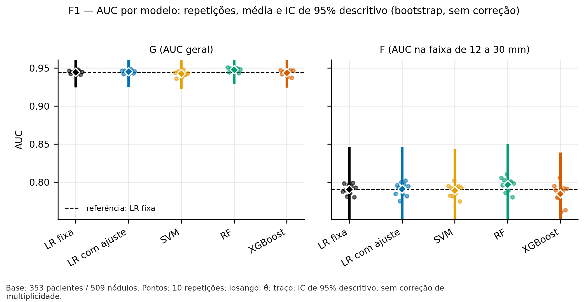

# Sprint 6 — Plano controlado de publicação e revisão do benchmark

**Projeto:** PI3-GRUPO-4 — Radiômica / LIDC-IDRI  
**Data de preparação:** 03/11/2026  
**Escopo:** organizar, conferir e apresentar evidências já produzidas; preparar integração e revisão por PR; encerrar o card somente após aceite.  
**Natureza:** instrução operacional de entrega, **não é adendo metodológico nem autorização para modificar o pré-registro P9**.

## 0. Contrato de execução para o Claude Code

Leia integralmente este plano, o pré-registro P9 em `docs/sprint6/preregistro_p9_benchmark.md`, a configuração em `docs/sprint6/config_benchmark_p9.json`, o relatório em `reports/sprint6/benchmark/resumo_benchmark.md`, os manifestos existentes, o adendo da S4 e os diagnósticos anteriores. **Verifique os estados reais** das worktrees e branches antes de agir; nomes e commits abaixo são referências reportadas, não substituem `git status`, `git log`, os arquivos reais nem testes.

Faça autonomamente apenas as tarefas técnicas que **não alterem dados, parâmetros, resultados experimentais, registros de aprovação ou artefatos verificados**. Cada fase só avança depois de seus critérios de aceite. Não execute novos experimentos. Não gere imagens médicas ou saídas sintéticas apresentadas como dados reais. Não altere/force aprovação, push, merge, rebase destrutivo, `--force`, nem marque o Trello como concluído sem autorização explícita. Consulte skills pertinentes apenas quando úteis. Em qualquer bloqueio de integridade, privacidade, inconsistência metodológica ou conflito de branches, pare a ação afetada e registre o motivo. Não modifique arquivos no diretório congelado `reports/sprint6/benchmark/` para melhorar a apresentação.

**Meta:** deixar um conjunto de commits e PRs *prontos para revisão*, com documentação de leitura humana e links rastreáveis; entregar um sumário verificável do que foi produzido e do que ainda depende de autorização. **Não confundir PR pronto com PR publicado/mesclado.**

## 1. Fontes e estado declarado (conferir localmente)

- Repositório: `RafaellLobo/PI3-GRUPO-4`; card Trello: <https://trello.com/c/06w7Zbh9/54-s6-p0-benchmark-de-lr-random-forest-xgboost-e-svm>.
- Worktree S6 indicada: `C:\PI3\PI3-s6`; branch `feat/s6-benchmark-executor`; execução definitiva e commit de relatório mencionados: `22d6a9b`.
- Branch da S4 indicada: `feat/s4-etapa3-validacao`; pré-registro P9: PR #11, inicialmente draft. Verificar mudanças locais e estado remoto atual antes de escrever qualquer instrução de integração.
- Branch de registro de estado relatada: `docs/s6-estado-final-benchmark` (não misturar automaticamente na branch congelada da execução).
- Configuração P9 da execução: hash canônico `a0d096a5415244f17f40360a2a5a8901bc8af1da5cf8687b891f920e1ee122b3` — verificar diretamente, não confiar apenas na transcrição.
- Resultado comunicado: 353 pacientes / 509 nódulos; desfecho F: 226 nódulos / 187 pacientes / 135 positivos / 91 negativos; 250 unidades; zero falhas técnicas pendentes; 38 saídas verificadas. Confirmar nos manifestos e no relatório.
- Suítes comunicadas: S4 508 testes aprovados; S6 613 aprovados e 1 ignorado. Reproduzir/registrar a evidência disponível; não declarar nova execução caso não tenha ocorrido.
- Evidência principal: `reports/sprint6/benchmark/resumo_benchmark.md`; números estruturados: `relatorio_benchmark.json`; configurações, agregados e manifestos no mesmo diretório.

## 2. Inventário: o que deve estar no repositório

### 2.1 Obrigatório: protocolo e governança

| Local | Conteúdo esperado | Verificação |
|---|---|---|
| `docs/sprint4/` | Protocolo, Emenda 1, adendo datado de reordenação, decisões P1–P4 conforme registros reais | Datas e commits anteriores às execuções afetadas; preservar ressalvas da P3 e condição da P4 |
| `docs/sprint6/preregistro_p9_benchmark.md` | P9, D1–D12, registro P9, registro `S4_E3_REGISTRADA`, explicação do hash novo e limitações | Linhas válidas, commits e valores canônicos conferidos |
| `docs/sprint6/config_benchmark_p9.json` | Configuração canônica efetivamente usada | Hash calculado por função oficial coincide com registro |
| `docs/sprint6/PLANO_EXECUCAO_AUTONOMA_BENCHMARK_S6.md` | Plano histórico usado | Informar que é plano, não resultado nem autorização |
| `docs/sprint6/` (novo documento de revisão, fora da pasta congelada) | Guia de leitura e evidências, por exemplo `GUIA_REVISAO_BENCHMARK_S6.md` | Sem copiar dados individuais nem editar relatório congelado |

### 2.2 Obrigatório: código e testes

| Local | Conteúdo esperado |
|---|---|
| `src/benchmark_s6/` | Implementação exata do P9: dados, folds, modelos, tuning, checkpoints, métricas, bootstrap, consolidação, seleção, figuras, manifesto e coordenador |
| `tests/benchmark_s6/` | Testes e guardas correspondentes; hashes e pins alinhados ao estado S4 efetivamente usado |
| `src/incremental/`, `tests/` da S4 | Implementação real da Etapa 3 e três sensibilidades, sem incluir trabalhos futuros da Etapa 1/2 como se estivessem concluídos |
| Declaração/fixação de ambiente existente | Python 3.9.13, scikit-learn 1.3.2, numpy 1.23.5, pandas 1.5.3, scipy 1.10.1, matplotlib 3.7.3 e XGBoost 2.1.4, conforme P9; não instalar/mudar versões apenas para publicação |

### 2.3 Obrigatório: evidências da execução S6 congelada

Na pasta **já existente** `reports/sprint6/benchmark/`, verificar a presença e hash de:

- `config_benchmark.json`, `plano_folds.json`, `denominadores.csv`;
- `auc_por_fold.csv`, `auc_por_repeticao.csv`, `contrastes.csv`;
- `bootstrap_resumo.json`, `bootstrap_delta.csv`, `hiperparametros_escolhidos.csv`, `metricas_descritivas.csv`;
- `selecao_algoritmo.json`, `relatorio_benchmark.json`, `resumo_benchmark.md`, `relatorio_execucao.json`, `manifesto_benchmark.json`;
- `figuras/F1.png` a `figuras/F8.png` **e** respectivas `F1.svg` a `F8.svg`;
- `figuras/dados/F1.csv` a `F8.csv`.

Verificar também os relatórios oficiais da S4 e seu manifesto em `reports/sprint4/` conforme o protocolo, com rastreabilidade de commits. **Não inferir caminhos ou nomes ausentes: procurar nos artefatos reais.** O teste histórico não entra nos resultados desta S6.

### 2.4 Explicitamente fora do repositório

- Arquivo-fonte local ignorado `data/modeling_table_sprint3.csv`, caso contenha dados individuais; dados por paciente/nódulo, predições individuais, atribuição de folds com `patient_id`, qualquer identificador sensível, checkpoints locais de `C:\PI3\checkpoints_s6_def`, segredos e logs com dados individuais.
- Não adicionar arquivos binários repetidos ou imagens de tomografia sem necessidade e autorização de divulgação.
- Não incluir os arquivos `piso_26_0_1.py`/`26_0_1_resumo.json` apenas porque foram citados pela equipe: primeiro obter a origem, verificar integridade, licença/privacidade e adequação; registrar como evidência ausente se não estiverem acessíveis.

## 3. Fases operacionais e critérios de aceite

### Fase A — Inspeção e integridade (sem edição)

**Executar:**
1. Em cada worktree, registrar branch, HEAD completo, `git status --short`, `git log --oneline -n 12`, `git remote -v` e `git branch -vv`. Distinguir commits locais, branches remotas, PRs existentes e arquivos ignorados.
2. Inspecionar o manifesto S6 e os artefatos citados. Rodar o modo `verificar` **na árvore e ambiente apropriados** conforme o protocolo, sem alterar os arquivos congelados. Se a guarda exigir HEAD/árvore específicas, documentar o impedimento em vez de contorná-lo.
3. Conferir hashes de configuração e manifesto, duplicações de artefatos, referências relativas e existência dos oito PNG/SVG/CSV.
4. Fazer verificação de privacidade em todos os **arquivos candidatos a commit**: proibir IDs de paciente/nódulo, `LIDC-IDRI-\d{4}`, arquivos individuais e dados identificáveis. Não mostrar conteúdo sensível no log.
5. Documentar quaisquer diferenças de hashes, manifestos ou estados antes de preparar publicação.

**Esperado:** inventário de arquivos e hashes; evidência de integridade; relatório de `git status`; lista de pendências. **Aceite:** verificação concluída ou bloqueio explícito e fundamentado. Nenhuma edição experimental.

### Fase B — Revisão editorial das figuras (somente avaliação)

Examine **visualmente**, sem alterar os arquivos congelados:

| Figura | Papel científico | Observação de revisão |
|---|---|---|
| F1 | AUC G e F, 10 repetições, média e IC95% descritivo | Conferir legenda e linhas de referência |
| F2 | Seis contrastes com IC Bonferroni e IC95% sem correção | Conferir linha zero e δ=0,02 |
| F3 | Distribuição de Δ por dobra e DD | Conferir leitura e escala |
| F4 | Frequência de hiperparâmetros e bordas da grade | **Há sobreposição e corte de rótulos no eixo inferior** |
| F5 | Curvas ROC médias e dispersão entre dobras (não IC) | **Rodapé/legenda explicativa inferior aparenta estar cortado** |
| F6 | Calibração por decis, sem SVM probabilístico | **Rodapé inferior aparenta estar cortado** |
| F7 | Denominadores do desfecho F por dobra | Conferir linha mínima de 5 por classe |
| F8 | Histograma bootstrap dos seis contrastes | Conferir linhas, intervalos e descartes |

**Regra:** não editar `figuras.py`, nem regenerar F1–F8 sobre os arquivos verificados nesta fase. Abrir um item editorial no guia de revisão: `F4/F5/F6: ajustes de layout sugeridos; nenhum dado ou métrica alterado`. Se a equipe pedir correção visual dos **originais**, criar intervenção controlada e uma nova execução de geração/verificação, atualizar hashes/manifesto e registrar nova revisão antes de substituir; **não** afirmar que o manifesto original continua valendo para arquivos editados.

**Esperado:** avaliação de legibilidade com pendências claramente marcadas. **Aceite:** as oito figuras foram inspecionadas ou as não inspecionadas foram identificadas; nenhuma figura corrigida silenciosamente.

### Fase C — Preparar guia científico legível para revisão

Criar **fora** de `reports/sprint6/benchmark/`, preferencialmente `docs/sprint6/GUIA_REVISAO_BENCHMARK_S6.md`, usando **referências relativas** para figuras existentes, por exemplo:

```markdown
## F1 — AUC geral e na faixa

```

Estrutura obrigatória do guia:
1. **Escopo e pergunta:** comparar LR ajustada, RF, XGB e SVM usando as três características de forma, LR fixa como referência; classificação de *suspeição radiológica*, não diagnóstico de câncer.
2. **Metodologia:** 353 pacientes/509 nódulos; CV aninhada agrupada por paciente (10 × 5 externas, 5 internas); mesmo desenho de folds; coorte F `12 ≤ D < 30 mm`, com 226 nódulos, 187 pacientes, 135 positivos, 91 negativos; excluir teste histórico de escolha/avaliação.
3. **Tabela principal:** cinco modelos × desfechos G e F, com AUC e IC95% do próprio relatório, sem arredondamentos que mudem interpretação.
4. **Contrastes:** RF/XGB/SVM menos LR ajustada para G e F; mostrar diferenças, IC com Bonferroni e IC descritivo; explicar o comparador e zero.
5. **Regra de escolha:** C1–C4; LR ajustada como recomendação operacional porque nenhum desafiante chega a ΔAUC geral ≥0,02; não confundir maior AUC pontual da RF com seleção confirmatória.
6. **Figuras F1–F8:** incluir referência relativa de cada PNG, 2–4 frases sobre *o que está representado*, *o que se observa* e *o que não se pode inferir*. Link para SVG e CSV associado. Não inserir novas interpretações além das permitidas no P9.
7. **Limitações:** IC condicional (sem retreinar no bootstrap), dependência entre dobras, otimismo da escolha, validação não independente, predição de alvo radiológico (não histopatologia), bordas das grades, reutilização de pacientes de validação da S4 após sua Etapa 3. Não atribuir generalização clínica.
8. **Rastreabilidade:** links relativos ao relatório congelado, JSON, configuração, manifesto, PRs e commits efetivamente existentes; não copiar dados individuais.
9. **Pendências e aceite:** pendências editoriais F4/F5/F6, escopo do diâmetro isolado, status S4 Etapas 1/2, análise posterior de circularidade e máscaras reduzidas, status de push/PR/merge e revisão humana.

**Resultados a transcrever, após conferência com JSON e relatório:**

| Modelo | AUC G | AUC F |
|---|---:|---:|
| LR fixa | 0,9442 | 0,7903 |
| LR com ajuste | 0,9449 | 0,7907 |
| SVM | 0,9424 | 0,7890 |
| RF | 0,9476 | 0,7968 |
| XGBoost | 0,9438 | 0,7844 |

**Esperado:** um documento acessível no GitHub que *mostre* as oito figuras sem mover nem duplicar os originais e explique cientificamente cada uma. **Aceite:** links relativos renderizam na branch proposta, números batem com relatório/JSON e nenhuma afirmação extrapola o estudo.

### Fase D — Reconciliar escopo do card e do P9

O card original menciona **“diâmetro isolado como referência”**, enquanto o P9 vigente compara cinco configurações que usam as **três** características de forma e registra LR fixa como referência histórica. **Não são o mesmo baseline.**

Criar no guia e no texto de PR um item explícito:

> **Revisão solicitada à equipe — escopo:** confirmar se a aprovação do P9 supre o requisito “diâmetro isolado” originalmente escrito no card ou se esta referência permanece como tarefa separada. O benchmark executado não deve ser rotulado como tendo incluído diâmetro isolado sem evidência correspondente. Nenhum experimento adicional será criado nesta entrega sem decisão formal.

**Esperado:** lacuna visível aos revisores, não omitida. **Aceite:** não afirmar DoD plenamente conciliado antes da resposta da equipe.

### Fase E — Preparar commits sem afetar o experimento

1. Listar todos os arquivos candidatos a commit; confirmar que os artefatos de S4/S6 que deveriam ser versionados já estão em commits existentes; evitar `git add .` indiscriminado.
2. Para a documentação nova, preferir **branch documental separada**, baseada no commit correto e sem reescrever histórico verificado. O guia pode ser incluído na revisão via PR específico ou como commit de documentação, sem modificar os 38 arquivos validados.
3. Não alterar `resumo_benchmark.md`, `manifesto_benchmark.json`, gráficos ou dados congelados só para exibição.
4. Criar commit documental descritivo somente após conferências e sem misturar alterações de S4, S6 ou dados.
5. Elaborar matriz de dependências real entre PRs (S4, P9 #11, executor S6) após inspecionar `merge-base`, diff e histórico. A integração local relatada na branch do executor não equivale à integração em `main`.
6. Se houver conflito ou diferenças no estado remoto, não fazer rebase/merge destrutivo nem recalcular manifesto em nova base sem protocolo; interromper e apresentar opções, com consequências para rastreabilidade.

**Esperado:** commits locais coerentes e PRs planejados, cada um com escopo preciso. **Aceite:** `git diff --check`, arquivos corretos e nenhuma evidência omitida.

### Fase F — Preparar conteúdo dos PRs e revisão humana

Preparar, **sem abrir/publicar automaticamente se faltar autorização**:

- **PR S4:** adendo de ordem, decisões P1–P4, implementação e sensibilidade da Etapa 3, relatórios oficiais, manifesto, testes, limitações, pendências das Etapas 1/2; explicar que a Etapa 3 não encerra a S4 integralmente.
- **PR #11 (P9):** alinhar a proposta documental ao pré-registro e configuração final, esclarecer hash atualizado, registros P9/`S4_E3_REGISTRADA`, aprovação e cadeia de commits; não confundir PR draft com aprovação de merge.
- **PR executor S6:** implementação, 250 unidades, relatório, hashes, figuras, testes, limitações, guia de leitura e checklist de evidências; dependência real dos PRs de S4/P9. Mencionar as restrições de verificabilidade caso integração em novo HEAD altere o manifesto ou a guarda.

**Modelo mínimo para cada descrição de PR:** objetivo; escopo fechado; mudanças; evidências e local dos arquivos; comandos/testes e resultado observado; governança/commits/hash; limitações; dependências; itens a revisar; checklist do DoD do card; exclusões intencionais.

**Esperado:** descrições de PR prontas para revisão, com links corretos após publicação. **Aceite:** autoria e aprovação humana não são inferidas; status `draft`, `open`, `merged` reportados conforme remoto.

### Fase G — Validação e entrega do pacote de revisão

1. Executar checagens apropriadas à documentação (`git diff --check`, verificação de links Markdown, inventário de evidências e triagem de privacidade).
2. **Não declarar** `--modo verificar` novamente aprovado sob HEAD diferente se a guarda não permitir; preservar evidência do estado validado e explicar a restrição.
3. Produzir um **resumo final fora dos artefatos congelados**: arquivos criados, arquivos preservados, commits locais, PRs existentes/propostos, testes realizados nesta fase, verificação de hashes, alertas editoriais, divergência do diâmetro isolado e decisões pendentes.
4. Se o usuário autorizar explicitamente push e publicação, usar **push sem force** para as branches aprovadas, atualizar PRs na ordem validada, conferir a visualização do Markdown e anexar URLs exatas no card do Trello. **Merge no `main` é autorização separada**; não assumir que push autoriza merge. Se não autorizado, limitar-se a preparar comandos e links futuros.
5. Marcar o card como concluído **somente depois** de a equipe revisar as evidências e decidir a divergência do diâmetro isolado, e de as integrações exigidas estarem concluídas. Não afirmar que S4 Etapas 1/2, circularidade ou máscaras reduzidas foram executadas.

**Esperado:** pacote pronto para revisão humana, sem alterações experimentais. **Aceite:** localização inequívoca de cada evidência, pendências honestas, nenhum dado individual publicado, PRs prontos ou efetivamente publicados apenas sob autorização.

## 4. Resposta final obrigatória do Claude Code

Relatar, nesta ordem:

1. **Resumo executivo:** pronto para revisão / bloqueado, com justificativa.
2. **Tabela de arquivo → propósito → commit → link relativo/PR → hash quando pertinente.**
3. **Estado dos PRs:** S4, P9 #11, S6, documentação; distinguir local e remoto.
4. **Integridade:** quantidade de artefatos existentes/verificados e estado dos testes; não preencher ausências com suposições.
5. **Figuras:** F1–F8 localizadas; problemas F4/F5/F6 e decisão sobre tratar ajustes apenas editorialmente.
6. **Análise da divergência do diâmetro isolado:** requer validação humana; sem novo treino.
7. **Pendências finais:** push, revisão, merge, Trello e trabalhos futuros da S4.
8. **Comandos/ações exatos para usuário revisar e publicar**, sem assumir consentimento para executar.

## 5. Limites de interpretação científica

- O alvo é **suspeição radiológica**, não diagnóstico de malignidade histopatológica.
- AUC G da RF maior numericamente não significa ganho relevante diante de LR ajustada, nem altera C1–C4.
- O IC bootstrap é descritivo/condicional; Bonferroni é convenção de intervalo sob as limitações declaradas, não garantia plena de inferência.
- O conjunto histórico de teste não é evidência independente e não foi usado no benchmark S6.
- Não inventar imagens de pulmão, localização de nódulos, predições por paciente ou interpretação clínica. Exemplos radiológicos seriam conteúdo ilustrativo separado, sujeitos à autorização de uso e privacidade.

---

**Comando de início sugerido ao Claude:**

> Leia `PLANO_PUBLICACAO_REVISAO_BENCHMARK_S6.md` integralmente. Execute as fases A–G dentro das autorizações existentes. Organize as evidências do benchmark S6 e crie o guia científico com F1–F8 incorporadas por caminhos relativos, sem alterar artefatos congelados. Prepare commits/PRs e a checklist de revisão; não faça push ou merge sem minha autorização. Pare diante de qualquer divergência de integridade, privacidade ou aprovação e apresente um relatório final rastreável.
